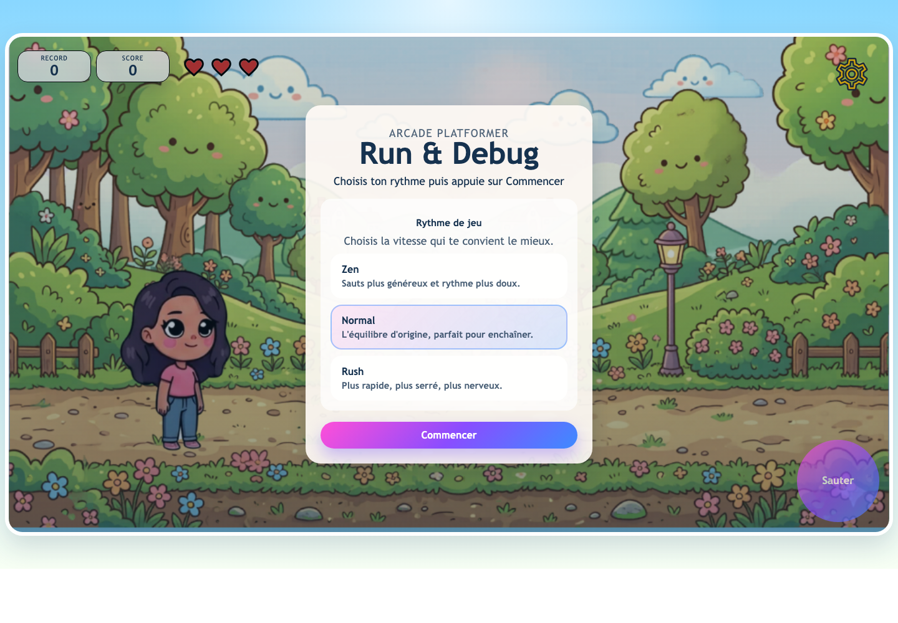

# Run & Debug

Un mini-jeu arcade dynamique axé sur le rythme, la précision des sauts et une interface claire pour suivre la progression.



## Objectif

`Run & Debug` est un endless runner au rendu `canvas` dans lequel on évite des bugs animés, on récupère des coeurs bonus et on tente de battre son record. Le gameplay, les obstacles et les décors reprennent la base d'EvaRun, avec un avatar inédit dessiné directement en code au runtime.

## Contrôles

- `Espace` pour sauter puis faire un double saut
- `Clic` ou `toucher l'écran` pour jouer sur desktop comme sur mobile
- `Bouton "Sauter"` affiché sur appareils tactiles pour une meilleure lisibilité

## Démarrage

```bash
npm install
npm run dev
```

Puis ouvrir l'URL fournie par Vite.

## Scripts

- `npm run dev` lance le serveur Vite
- `npm run build:atlases` régénère les atlas WebP à partir des sources lourdes
- `npm run build` produit le build de production
- `npm run preview` prévisualise le build
- `npm run test` lance les tests unitaires Node sur la logique pure

## Choix Techniques

- `Vite` comme outillage léger pour le développement et le build
- `JavaScript ES modules` avec une structure `src/` plus claire
- `Canvas 2D` pour le rendu temps réel
- séparation du code entre `engine`, `renderer`, `input`, `ui`, `logic`, `assets`
- `localStorage` pour mémoriser le record et la difficulté choisie

## Structure

```text
assets/
  atlases/
  coeur.svg
assets-src/
  Bug/
  bug_b/
src/
  game/
    assets.js
    atlas-manifest.js
    config.js
    engine.js
    input.js
    logic.js
    renderer.js
    storage.js
    ui.js
  styles/
    main.css
test/
  game-logic.test.js
```

## Workflow Assets

- `assets-src/` contient uniquement les masters des obstacles
- `assets/atlases/` contient les atlas WebP réellement servis au runtime pour les bugs
- après modification d'un master, relancer `npm run build:atlases`
- `src/game/atlas-manifest.js` est généré automatiquement par ce script

## Évolutions Apportées

- découpage du jeu monolithique en modules spécialisés
- ajout de trois niveaux de difficulté: `Zen`, `Normal`, `Rush`
- meilleur confort mobile avec un bouton de saut dédié
- ajout de tests sur la logique de collision et de rythme de jeu
